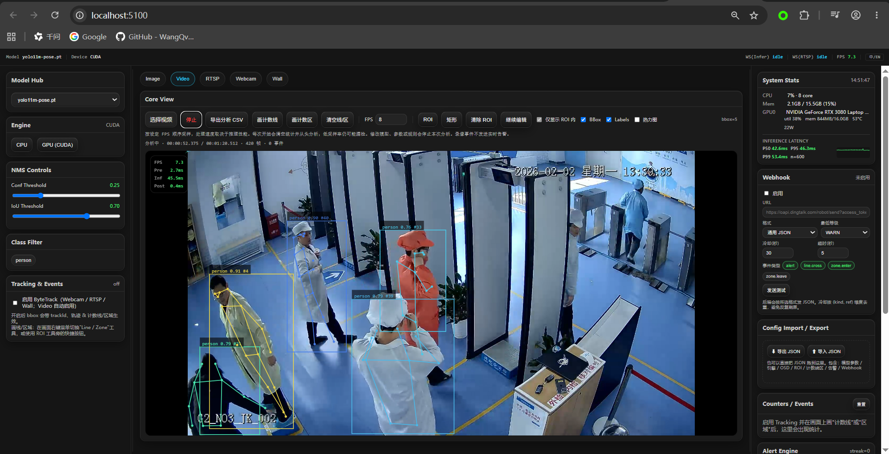

<div align="center">

# UltraConsole
### AI监控识别程序

**核心组件：视频事件语义分析控制台
—— 图像确定性信号 + Qwen视觉大模型判定**

[](LICENSE)
[](#)
[](#)
[](#)
[](#)
[](#)

</div>

<p align="center">
  
</p>

**视频事件语义分析控制台**：Yolo pose 开源目标检测算法 - 画面检测、人物姿态 + 事件规则判定 + Qwen3-VL-4B视觉语言模型 语义分析
调用Cuda显卡加速 处理监控视频画面，从人员轨迹中找出**候选事件时间点**，再判断**事件是否真的发生**——把传统图像信号与视觉语言大模型（VLM）结合起来做判定，并输出带证据、可回放、可人工复核的结果。
聚焦**事件级核验的可靠性**，而非单纯的检测。

---

## 为什么需要 AI监控识别程序

检测“谁在何时跨了线”很容易；判断“告警是否真的发生”——例如 **“人员通过安检门，安检警报，但是未退出重新接收安检”** ——则是更难、也更关键的问题。

目前把检测逻辑拆成两层：

- **确定性层** —— 可测量的信号用传统 CV 直接计算（红灯检测、入口线跨越、退回几何），不经过大模型就能给出可审计的结论。
- **VLM 层** —— 只有真正模糊的样本才交给 **Qwen3-VL**，并且现在模型输出的是**逐条件、带证据的结构化结果**（`是 / 否 / 不确定` + 证据时间），而不是一段自由文本猜测。

这样的设计消除了最大的一类误报（由轻量模型全部处理事件存在幻觉），同时让大模型在真正有价值的地方发挥作用。

---

## 功能特性

### VLM 语义事件分析（核心）

- **确定性优先判定** —— 红灯信号检测（经典 CV）、入口线退回、轨迹连续性直接计算；只有不确定样本才交给 VLM。
- **结构化判定输出** —— 模型逐条件给 `是/否/不确定` + 证据时间，由代码按“合取真值表”规则合并出最终结论（而不是直接采信模型的一段话）。
- **默认否认提示词** —— “看不清就不算发生”，抑制“复述规则文字”式的幻觉。
- **信号区阈值校准** —— 提供 前端参数校准工具，测量红像素占比随时间的变化并给出建议阈值；阈值可在界面按相机分别配置。
- **入口方向计数线** —— 单向闸门只算正向跨越；窗口内反向跨越视为“退回”。
- **结果可审计** —— 每条结论都带原因、逐条件证据、以及可点击回放的证据帧。

### 经典 CV 控制台

- 实时 YOLO 检测、计数线/区、系统监控、告警引擎、事件日志。

### 数据库与可维护性

- **带时间戳的记录名**（`video_20261105_1730`）与每条记录的**处理时长**。
- 单页的记录与视频管理，无弹窗。
- **启动即就绪** —— 启动时自动选择 CUDA 并加载姿态模型，无需手动选设备/模型。

---

## 工作原理

```
上传视频 ──► 画计数线 / 计数区 / 信号区 ──► 定义事件规则
        │
        ▼
  ┌─ segment      关键帧对齐分段（逻辑分段）
  ├─ tracking    YOLO11m-Pose + ByteTrack → observations.sqlite
  ├─ cues        经典 CV 红灯检测 → 亮/灭区间          （可选）
  └─ understanding
        ├─ 确定性判定（红灯状态 + 退回 + 轨迹连续性）→ match / no_match
        └─ 不确定 → Qwen3-VL 逐条件结构化复核
        │
        ▼
   results.jsonl  （时间 · 结论 · 原因 · 证据）──► 库
```

候选**时间点**来自姿态跟踪的状态机（对 `(跟踪ID, 跟踪段, POI)`）：跨线、进区、出区、首次在区内。只有匹配事件 `triggerKinds` 且绑定到对应 POI 的触发才会成为候选。
目前成功实现准确率较高的可检测事件规则：人物进出选定区域安检报警 + 物品推车进出选定区域检测动作。
更多其他事件规则待后续添加调整优化。

---

## 技术栈

| 层次 | 技术 |
|---|---|
| 后端 | Python 3.10、FastAPI |
| 前端 | React 19、TypeScript、Vite、Zustand |
| 跟踪 | YOLO11m-Pose + ByteTrack |
| 语义判定 | Qwen3-VL（2B / 4B） |
| 媒体处理 | PyAV（探测、解码、重封装） |
| 测试 | pytest、Ruff、Vitest、ESLint |

---

## 快速开始

### 环境要求

- **Linux** 或 **Windows WSL2**
- **NVIDIA GPU**，驱动支持 CUDA（WSL2 需能访问 `/dev/nvidia*`）
- **Conda**（或等价环境管理器）与 **Node.js ≥ 20**

### 1. 创建两个 Python 环境

```bash
# 后端 / 姿态跟踪
conda create -n ultraconsole python=3.10 -y
conda activate ultraconsole
pip install ultralytics fastapi uvicorn av pydantic pillow numpy

# VLM 推理（bf16）
conda create -n qwen3vl-bf16 python=3.10 -y
conda activate qwen3vl-bf16
pip install torch transformers accelerate av pillow numpy qwen-vl-utils
```

### 2. 放置模型权重

| 模型 | 用途 | 位置 |
|---|---|---|
| `yolo11m-pose.pt` | 人员跟踪 | `backend/models/` |
| `yolov8n.pt` | 经典 CV 检测（可选） | `backend/models/` |
| `Qwen3-VL-2B-Instruct` / `4B` | 语义判定 | 项目内 `models/`（默认加载位置） |

### 3. 配置（可选）

```bash
# 默认从项目内 models/ 加载，无需设置；仅在挂载到其他路径时才需要覆盖
# export VLM_MODEL_PATH=/path/to/Qwen3-VL-2B-Instruct
# 默认与后端使用同一个 Python；Qwen 跑在独立环境时再指定
export VLM_PYTHON=/path/to/qwen-env/bin/python
export ULTRA_API_TOKEN=your-token   # 可选，启用鉴权
```

### 4. 启动

```bash
./start.sh 5100
```

打开 **http://localhost:5100**。后端启动时会自动选择 CUDA 并加载姿态模型。

### 5. 跑一次分析

1. 上传视频。
2. 画入口计数线，并按需画信号区（红灯）或计数区。
3. 定义事件规则，并绑定到 POI/信号区。
4. 点击「开始」，结果会带证据出现在库里。

---

## 配置项

| 变量 | 默认值 | 作用 |
|---|---|---|
| `VLM_MODEL_PATH` | 项目内 `models/Qwen3-VL-2B-Instruct` | Qwen3-VL 模型目录 |
| `VLM_MODEL_ROOT` | 项目内 `models/` | 权重发现根目录（容器挂载时覆盖） |
| `VLM_PYTHON` | 当前 Python | VLM 推理解释器（独立环境时覆盖） |
| `VLM_POSE_PYTHON` | 当前 python | 姿态/跟踪解释器 |
| `VLM_DATA_ROOT` | `Rules/data/vlm` | 分析数据根目录 |
| `ULTRA_API_TOKEN` | *(空)* | HTTP 鉴权令牌 |
| `ULTRA_MODELS_DIR` | `backend/models` | 检测模型目录 |
| `ULTRA_DEVICE` | *(自动)* | `cpu` / `cuda` |
| `ULTRA_AUTOSTART` | `true` | 启动时自动选设备并加载模型 |
| `ULTRA_DEFAULT_MODEL` | `yolo11m-pose.pt` | 默认检测模型 |
| `VLM_SEGMENT_SECONDS` | `600` | 分段时长（秒） |
| `VLM_MAX_UPLOAD_BYTES` / `VLM_MAX_DURATION_SEC` | `8 GiB` / `7200` | 上传大小/时长限制 |

---

## 项目结构

```
.
├── backend/            # FastAPI 服务（路由、运行时、规则、库）
│   ├── app/
│   └── models/         # yolo11m-pose.pt, yolov8n.pt
├── models/             # 项目内模型权重（Qwen3-VL-2B/4B，默认加载位置；不入库）
├── Rules/              # 纯算法库（无 Web 依赖）
│   ├── src/ultra_rules/vlm/   # 契约、跟踪、信号、判定、采样、提示词、worker
│   └── configs/        # 示例事件规则
├── frontend/           # React + TS + Vite
├── start.sh / stop.sh  # 启动/停止脚本
├── dev-guide.md        # 技术开发指南（中文）
└── REPORT.md           # 管理层汇报（中文）
```

---

## 路线图

| 状态 | 内容 |
|---|---|
| ✅ | 确定性判定（红灯 CV、退回、后处理否决、触发收紧） |
| ✅ | 结构化判定输出 + 默认否认提示词 |
| ✅ | 阈值校准 + 入口方向 |
| ✅ | 带时间戳记录名 + 处理时长 |
| 🔶 | 高分辨率 ROI 抽帧、4B/8B 模型、多次投票、置信度校准 |
| ⬜ | 标注评测集 + precision/recall 指标 + 人工复核闭环 |

> 实测处理吞吐（RTX 3080 16G）：跟踪约 **57.5 帧/秒**（≈ 视频时长 ÷ 5.75）。2 小时视频约 40–60 分钟，24 小时约 10-13 小时。

---

## 部署（Docker / Windows 一键包）

项目已把**模型权重 / 配置 / 数据**与代码分离，并提供完整的交付物生成流程：
镜像本身不含 PyTorch 依赖与权重，首次启动自动安装到挂载卷；前端与 API 同源，只暴露 `8001`。

```bash
./deliverable/build.sh     # 构建镜像 + 导出 tar + 生成 Windows 交付包
```

产物在 `deliverable/dist/`。Windows 用户解压后双击 `启动.bat` 即可（首次会下载依赖与权重）。
构建说明见 `deliverable/README.md`，部署步骤见 `deliverable/docs/部署手册.md`。
依赖与权重默认使用国内直连源（清华 PyPI / 阿里云 apt / npmmirror / ModelScope），YOLO11 权重随包内置，无需代理。

在 Linux + NVIDIA Container Toolkit 上也可以直接复用同一份 compose：

```bash
cd deliverable/dist/UltraConsole-1.0.0-Win64
docker compose run -T --rm setup   # 首次：安装依赖、下载权重
docker compose up -d              # 启动，访问 http://localhost:8001
```

---