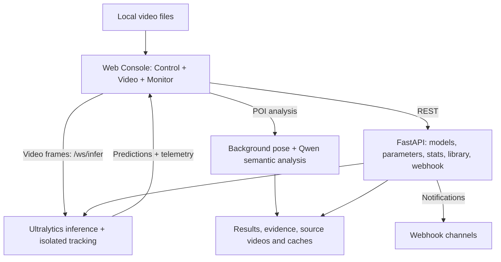

# Ultralytics Industrial Inference Console

**English** | [中文](README.md)

<p align="center">
  
  
  
  
  
  
  
</p>

<p align="center">
  <a href="https://github.com/WangQvQ/ultraconsole/blob/main/LICENSE"></a>
  <a href="https://github.com/WangQvQ/ultraconsole/stargazers"></a>
  <a href="https://github.com/WangQvQ/ultraconsole/issues"></a>
  <a href="https://github.com/WangQvQ/ultraconsole/commits"></a>
  
</p>

<p align="center">
  
  
  
  
  
  
  
  
  
</p>

An **industrial-grade object detection visualization console** for quality inspection, surveillance, and algorithm tuning: hot-swap models, live parameter tuning, local video analysis input, OSD overlays (segmentation/pose), ByteTrack tracking + line/zone counting events, spatial heatmap, GPU/CPU/latency monitoring, Webhook alerting, config import/export.

The home page opens **Video** directly. Image, RTSP, Webcam, Wall, the offline Rules page, and their dedicated APIs have been removed. `Rules/` retains the VLM implementation and shared pose/geometry code used by Video semantic analysis; existing semantic-analysis data paths remain compatible.

## Screenshot


## Highlights

- **Industrial Dark Theme + Neo-Skeuomorphism**: Designed for long monitoring sessions; critical status at a glance.
- **Zero-blocking real-time redraw**: OSD overlays use Canvas, keeping high-frequency graphics out of React render; ResizeObserver attached only once.
- **Background inference**: Video frame inference uses `asyncio.to_thread`; YOLO calls are serialized.
- **Sequential video analysis**: Video processes scheduled samples sequentially, taking longer when inference is slow.
- **Observability closed-loop**: HUD telemetry + system resource panel (CPU/GPU/VRAM/temp/power) + inference latency P50/P95/P99 + structured event stream + CSV export.
- **External alerting**: Built-in DingTalk / WeCom / Feishu / Slack / Generic JSON webhook formats with (kind, ref) cooldown deduplication.
- **Object Tracking + Events**: Built-in ByteTrack; draw "counting lines" / "counting zones" for in/out or enter/leave statistics; stable trackId colors + trail visualization.
- **Partial reports on disconnect**: Video disconnects end the run and preserve partial results.
- **Portable config**: One-click JSON export (params/engine/OSD/ROI/lines-zones/alerts/webhook); drag JSON to another machine to apply instantly.
- **Replaceable inference kernel**: Default `pip install ultralytics`; supports swapping to your custom ultralytics fork.

## Features

### Model & Environment Control

- **Model Hub**: Select models from `backend/models/` dropdown (`.pt/.onnx/.engine`), path whitelist validation
- **Engine**: CPU/CUDA toggle; same device = no-op, different device = warmup only (no weight reload)
- **NMS**: Conf/IoU sliders with live adjustment; frontend 200ms debounce writeback
- **Class Filter**: Multi-select label filtering
- **Tracking**: Video analysis automatically enables ByteTrack; bboxes carry `#trackId`

### Input Sources

- **Video**: Sequential sampling of local videos (configurable FPS), **drag & drop**, isolated ByteTrack tracking, line/zone counting, video timestamps, and analysis CSV export.

### Visualization & Efficiency

- **OSD**: BBox / Labels / Masks (instance segmentation semi-transparent) / Keypoints (COCO-17 skeleton) / Trails (trajectory tail)
- **Stable Colors**: trackId hashed to HSL for consistent cross-frame coloring
- **Telemetry HUD**: FPS / Latency (Pre/Infer/Post)
- **ROI**: Polygon + Rectangle draw modes; "show only ROI targets" (display filtering); touch-screen supported. Counting Line / Zone rules define counting geometry separately
- **Counting Line / Zone**: Draw lines/zones on canvas for automatic in/out or enter/leave counting

### Monitoring & Data

- **Event Logger**: Scrolling structured logs, CSV export `/api/logs/export.csv`
- **Alert Engine**: Class consecutive N-frame trigger (red breathing border + optional beep); excluded from recorded-video analysis
- **Counters / Events**: Real-time line in/out, zone current/total counts + latest 30 event stream
- **System Stats**: CPU% / Mem / Multi-GPU util/VRAM/temp/power + Inference latency P50/P95/P99 + 60-frame sparkline
- **Webhook**: DingTalk / WeCom / Feishu / Slack / Generic JSON; alert + counting events real-time push; (kind, ref) cooldown dedup; recorded-video events are excluded
- **Config Import / Export**: One-click JSON export; drag JSON to panel to apply

## Video Analysis and Counting

1. Select a model in Model Hub, open **Video**, and select or drop a local video. If browser decoding fails, the backend uses PyAV / FFmpeg with NVIDIA NVDEC (CUVID) hardware decoding and NVENC hardware encoding to create an H.264 MP4 preview (video only), with conversion progress and cancellation. The original file is preserved. The default upload limit is 2 GiB (`ULTRA_VIDEO_MAX_UPLOAD_BYTES`); long recordings must finish converting before analysis. Completed MP4 files are retained in `data/video-previews/` at the project root (override with an absolute `ULTRA_VIDEO_PREVIEW_DIR`). Filenames use the original content SHA-256; matching JSON files record original filenames. Reuploading identical content reuses the conversion, including after renaming the file or restarting the backend. Switching files or leaving the page releases only the session; 24-hour cleanup applies only to sessions and temporary uploads. Open saved MP4 files directly, or manually remove unused MP4/JSON pairs to reclaim space.
2. Choose **Draw counting line** and click two endpoints, or choose **Draw counting zone**, click at least three vertices, then click the first vertex to close the polygon. Click **Finish drawing** when ready.
3. Set the sampling FPS (1–30, default 8) and choose **Analyze from start (with tracking)**. Video enables ByteTrack automatically, independently of the live-stream Tracking checkbox.
4. Read line directions, zone occupancy, cumulative entries and video timestamps in Counters / Events.
5. After completion or stopping, choose **Export analysis CSV**. Export before switching files or leaving Video; the report is held only in the current page's memory.

Preview conversion uses NVIDIA GPU 0 independently of the YOLO inference device. Unavailable hardware, drivers or unsupported video profiles fail with an error; **CPU codec fallback is disabled**. Conversion runs in a separate process that is terminated on cancellation. File I/O, muxing, frame transfers and necessary pixel format conversion still involve CPU work. This applies to server-side upload preview conversion; browser playback and other analysis paths are separate.

Every run clears counts, starts at the beginning and opens a new tracking connection. Playback controls are disabled during analysis. You can preview or seek after stopping; the next run still starts from the beginning. Changing the model, device, inference parameters or counting rules stops the current run to avoid mixing results.

Samples follow video times `0, 1/FPS, 2/FPS…`, with each prediction received before sending the next frame. Processing speed depends on inference performance. This does not process every original frame: low sampling rates, missed detections and tracking ID changes can still affect counts.

| Metric / report field | Meaning |
|---|---|
| Line `in / out` | Two directions in which tracked box centers cross the finite counting segment; direction depends on endpoint order |
| Zone `current` | Tracked targets inside the zone in the current sample |
| Zone `total` | Cumulative entries, including targets first observed inside the zone; not unique people |
| Event timestamp | Time within the video, such as `00:02:35.125` |
| CSV metadata | Filename, duration, sampling FPS, processed frames, last sample time, model, parameters and rule snapshots |
| CSV details | Totals and all events, independent of the UI's 500-event history and latest-30 display |
| CSV status | `completed` / `stopped` / `error`; stopped or failed reports cover only processed samples |

Recorded-video analysis does not trigger Alert Engine or Webhook notifications. Its analysis CSV is separate from the Event Logger's runtime-log CSV.

## Project Structure

```
backend/                    # FastAPI + Ultralytics inference service
├── app/
│   ├── main.py             # REST + Video WS (/ws/infer)
│   ├── config.py          # Environment settings / resource limits
│   ├── security.py        # REST / WS auth and URL validation
│   ├── infer_runtime.py    # YOLO load/infer/track, masks + keypoints extraction
│   ├── system_stats.py     # CPU/GPU monitoring + inference latency ring buffer
│   ├── webhook.py          # Webhook config persistence + multi-format dispatch
│   ├── schemas.py          # Pydantic models (trackId/masks/keypoints/SystemStats)
│   ├── logging_store.py    # In-memory ring buffer + CSV export
│   └── state.py            # Global mutable state (params / engine / logs)
├── models/                 # Weight files (gitignored)
├── tests/                  # Backend regression tests
├── requirements-dev.txt    # pytest / Ruff
└── requirements.txt

frontend/                   # React 19 + Vite + TypeScript + zustand
└── src/
    ├── pages/ConsolePage   # 3-column layout (left control / center view / right monitor), draggable dividers
    ├── ui/
    │   ├── control/        # ControlPanel: Model/Engine/NMS/Class/Tracking
    │   ├── viewer/
    │   │   ├── tabs/       # Video
    │   │   └── widgets/    # CanvasOverlay / VideoCanvasOverlay / RoiOverlay /
    │   │                   # EventEditOverlay / TelemetryHUD
    │   ├── monitor/        # SystemStatsCard / WebhookCard / ConfigCard /
    │   │                   # MonitorPanel (Counters/Events/Alert/Logs)
    │   ├── status/         # Top bar SystemStatusBar
    │   └── primitives/     # Card / NeoButton
    ├── store/              # zustand global store
    ├── api/                # REST / WS utilities + shared contracts.ts types
    ├── i18n/               # Internationalization (zh/en)
    └── utils/              # draw / events / roi / configIO / reconnectWs /
                            # useEventTracker / useSystemStats /
                            # useWebhookDispatcher / badcase / videoAnalysis / binaryFrame
```

## Quick Start

Requirements: Python 3.10+, Node.js 22.12+, and npm. CUDA inference requires compatible NVIDIA drivers and PyTorch; CPU inference does not require NVIDIA hardware.

### 1) Prepare Model Files

Place weight files in `backend/models/*.pt` (or `.engine/.onnx`)

### 2) Start Backend (FastAPI)

#### Option A: venv

```bash
cd backend
python3.12 -m venv .venv
source .venv/bin/activate
python -m pip install -r requirements.txt
uvicorn app.main:app --reload --port 8001
```

#### Option B: conda

```bash
conda create -n ultraconsole python=3.10 pip -y --override-channels -c conda-forge
conda activate ultraconsole
cd backend
python -m pip install -r requirements.txt
uvicorn app.main:app --reload --port 8001
```

> Install all dependencies in `requirements.txt`. Without an NVIDIA driver, GPU metrics are unavailable but CPU inference can run. `httpx` is required for backend startup.

### 3) Start Frontend (React)

Open another terminal at the repository root:

```bash
cd frontend
npm ci
npm run dev
```

Open `http://localhost:5173` by default and select a model. The frontend dev server proxies `/api` and `/ws` to `http://127.0.0.1:8001`.

## Configuration

| Item | Default | Source |
|---|---|---|
| Backend port | `8001` | Startup command |
| Models directory | `backend/models/` (resolved from the backend source location) | Env `ULTRA_MODELS_DIR` |
| Webhook persistence | `backend/.webhook.json` (gitignored) | Env `ULTRA_WEBHOOK_FILE` |
| Default device | `cpu` | Env `ULTRA_DEVICE=cuda` |

### Security and resource limits

Settings are read from the backend process environment. To use a file, run `cp .env.example .env` inside `backend/`, edit it, and start with `uvicorn app.main:app --reload --port 8001 --env-file .env`. Copying the file alone does not load it.

- `ULTRA_API_TOKEN` protects every REST endpoint except health and all WebSockets; build the frontend with the same `VITE_ULTRA_API_TOKEN`
- `ULTRA_CORS_ORIGINS` is a comma-separated Origin allowlist; it defaults to local development origins
- `ULTRA_MAX_UPLOAD_BYTES` / `ULTRA_MAX_IMAGE_PIXELS` limit uploads and decoded image size
- `ULTRA_MAX_WS_BASE64_CHARS` caps encoded WebSocket frame length (default 16 MiB characters)
- `ULTRA_MAX_TRACKER_CONTEXTS` caps independent tracking contexts (default 10); each adds model RAM/VRAM usage
- `ULTRA_ALLOW_PRIVATE_WEBHOOKS` defaults to `false`, blocking loopback, private and link-local webhook targets

When enabling authentication, set the matching `VITE_ULTRA_API_TOKEN` in `frontend/.env.local`, then restart the dev server or rebuild. No backend token means credential checks are disabled. REST clients can send `Authorization: Bearer <token>`; browser WebSockets use the `ultra-token.<base64url-token>` subprotocol.

The token is compiled into the browser bundle, so treat it as a deployment-level shared access credential and never reuse it for another system.

## REST / WebSocket API

### REST

| Method | Path | Description |
|---|---|---|
| `GET` | `/api/health` | Health check |
| `GET` | `/api/models` | List available models in `models/` + current loaded model backfill |
| `POST` | `/api/models/select` | Load model (`{modelId}`, path whitelist + extension validation) |
| `POST` | `/api/engine/select` | Switch CPU/CUDA (`{device}`, same device = no-op) |
| `GET` `/POST` | `/api/params` | Get/update `{conf, iou, classFilter, track}` |
| `GET` | `/api/system/stats` | CPU/GPU/Mem + inference latency percentiles |
| `GET` `/POST` | `/api/webhook` | Get/save webhook config |
| `POST` | `/api/webhook/test` | Connectivity test |
| `POST` | `/api/notify` | Dispatch alert/event to webhook |
| `GET` | `/api/logs/export.csv` | Structured log CSV export |

### WebSocket

- `/ws/infer` — Video frame push channel: client sends `{type:'frame', imageJpegBase64, ...}`, server returns `{type:'pred'|'log'}`; accepts `{type:'ping'}` → `{type:'pong'}`

## Using a Custom ultralytics Fork

### Option 1: Editable local source install

```bash
conda activate ultraconsole   # or source backend/.venv/bin/activate
python -m pip uninstall -y ultralytics
python -m pip install -e ~/work/ultralytics

cd backend
uvicorn app.main:app --reload --port 8001
```

Source changes take effect on uvicorn restart — no reinstall needed.

### Option 2: Point dependency to local path

Change `ultralytics` in `backend/requirements.txt` to:

```txt
-e /absolute/path/to/ultralytics
```

## Webhook Configuration (DingTalk Example)

1. In the monitoring panel Webhook card:
   - Check "Enable"
   - Paste DingTalk custom robot webhook URL (recommend "custom keyword" security mode)
   - Format: "DingTalk", minimum level `WARN`, cooldown 30s
   - Event types: check `alert`, `line.cross`, `zone.enter`
   - Click "Send Test" → group receives `ℹ️ [INFO] Webhook test`
Recorded-video counting events are saved in reports and do not send live Webhook notifications. Use Send Test to check notification connectivity.

## Architecture



## FAQ

### 1) Will model/weight files be committed to the open-source repo?

No: the repo's `.gitignore` already excludes `backend/models/**/*.pt|onnx|engine` and other large file types, as well as `backend/.webhook.json` (contains external URLs).

### 2) GPU monitoring panel shows "NVML unavailable"?

This means `nvidia-ml-py` is not installed or the machine has no NVIDIA driver. CPU/Mem still works (via `psutil`); inference is not affected.

### 3) Webhook dispatch rejected by DingTalk?

DingTalk custom robots with "signature security" or "IP whitelist" will fail. Start with "custom keyword" mode (simplest), setting keywords like "alert" / "UltraConsole".

### 4) What happens when Video analysis disconnects?

The run ends and partial results remain available for export. Starting again creates a new tracking context and analyzes the video from the beginning.

### 5) Does the exported config JSON contain webhook URLs in plaintext?

Yes. The exported file contains sensitive URLs without masking in the UI. For stricter security, manually remove the webhook field before export, or add an "export without webhook" toggle later.

## Development and Validation

Run from the repository root with your backend virtual environment activated:

```bash
python -m pip install -r backend/requirements-dev.txt
python -m pytest
ruff check backend/app backend/tests
npm --prefix frontend ci
npm --prefix frontend test
npm --prefix frontend run lint
npm --prefix frontend run build
```

GitHub Actions runs backend/frontend tests, static checks and the frontend build on pushes and pull requests. Tests cover validation, access control, tracking isolation, latest-frame queues, binary frames, Video counting and reports. Model accuracy, actual video decoding and GPU/camera compatibility require real samples and devices.

## Contributing

- Issues/PRs welcome:
  - Bug: include reproduction steps, logs, and video format and analysis settings
  - Feature: suggest opening an Issue first to discuss interface and interaction
- Roadmap (✅ = shipped):
  - ✅ Video analysis, ByteTrack + Events, Segmentation/Pose, GPU/CPU HUD, Latency percentiles, Webhook, Drag-and-drop, Config import/export
  - ✅ Chinese/English i18n, spatial heatmaps, Video sampling and counting reports, optional Token auth, security/resource limits, tests and CI
  - ⏳ Model A/B comparison, SQLite persistence, Screenshot export, Plugin system

### Records and video library

Click **Records & videos ↗** in the console header to open a separate management window, or visit `/library` directly (currently `http://localhost:5100/library`). Browse saved semantic analyses and converted videos with category filters, name/original filename/ID search, pagination, video previews and downloads, result/evidence viewing, renaming and bulk deletion.

Renaming persists a display name while retaining original filenames, run IDs and video cache keys. Deletion requires confirmation, and running analyses cannot be deleted. Removing an analysis deletes that run's results and evidence while retaining shared uploaded sources. Removing a converted video deletes its MP4, metadata and legacy preview hard links; reuploading its original requires conversion again. Live session logs are not part of this persisted library.

### Custom semantic event definitions

Use **Video → POI video semantic analysis → Event definitions** to add, edit and copy individual rules. Selection checkboxes control batch actions; analysis switches control participation. Edits and enable/disable changes remain drafts until saved individually, by selection or together. Bulk entry accepts one description per line. JSON/TXT imports offer a preview and explicit matching-ID updates or new-copy creation; JSON export retains advanced definitions.

Each rule supports trigger types, pre/post sampling windows, conditions and uncertainty conditions. POI bindings are specific to the current analysis, not the reusable template. Missing bindings block analysis. Up to 30 rules can be enabled per analysis; the library supports 1000 rules. Unsaved changes are committed by **Save rules and start analysis**.

Definitions persist in `Rules/data/vlm/event-rules.json` under `VLM_DATA_ROOT`. Revision checks prevent stale windows from overwriting other edits; conflicts retain local drafts for export or reload. Batch writes are atomic. Runs retain the selected rule names, versions and effective definitions, independent of subsequent edits or deletions. Snapshots are available in task history and the separate records window.

### Video descriptions and judgment rationale

New tasks save and display separate Qwen video-content descriptions and judgment rationale. Descriptions cover the target’s visible sequence of actions, event-related details and visibility gaps; rationale relates those observations to event conditions, timing and missing evidence. Full text is available in console results, segment evidence and library details. These remain model-generated observations for human review, not verified facts.

The default output limit is 1024 tokens and the maximum is 2048. Lower browser preferences are preserved, with a button to apply the recommended limit. Historical records retain their original text; rerun an analysis to generate the new descriptions.
